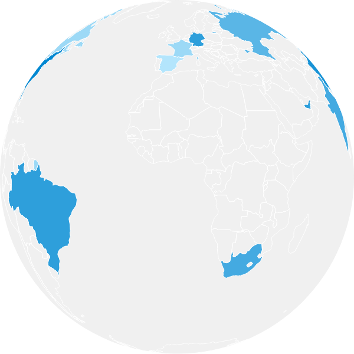
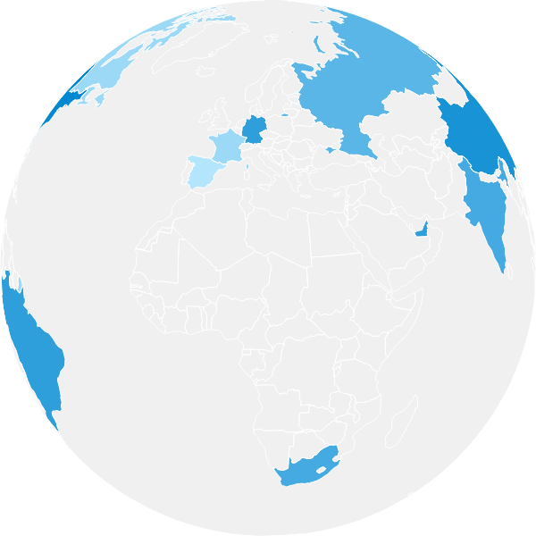
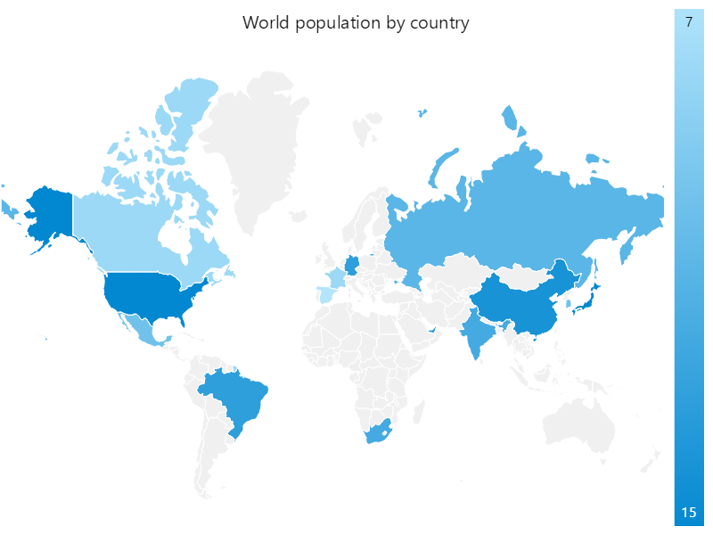

<!--
To get help on editing this file, see https://github.com/beto-rodriguez/LiveCharts2/blob/master/docs/readme.md
Samples are pulled from the repository with render_sample, the code shown always matches the samples.
-->

# Geo maps

The `GeoMap` control draws a map from a [GeoJSON](https://en.wikipedia.org/wiki/GeoJSON) file: every feature of the
file is a land (a country, a state, a region) drawn as a vector shape. A world map is built in. A `HeatLandSeries`
gives a value to some of the lands and paints each one with a color taken from a gradient, the result is a
[choropleth map](https://en.wikipedia.org/wiki/Choropleth_map).

:::info
This article highlights the most used features. Every property is listed in the API explorer:
[GeoMap]({{ website_url }}/api/{{ version }}/LiveChartsCore.SkiaSharpView.{{ platform }}.GeoMap),
[HeatLandSeries]({{ website_url }}/api/{{ version }}/LiveChartsCore.SkiaSharpView.HeatLandSeries) and
[GeoMapChart]({{ website_url }}/api/{{ version }}/LiveChartsCore.GeoMapChart) (the `CoreChart` of the control).
{{~ if xaml ~}}
There is no XAML version of `HeatLandSeries`: create the series in code and bind the `Series` property. Declare the
title as `XamlDrawnLabelVisual`.
{{~ end ~}}
:::

## Basic map

Add a `HeatLandSeries` to the `Series` of the map and fill its `Lands` with `HeatLand` items. The `Name` of a
`HeatLand` is the short name of a land in the map, and its `Value` sets the color of that land. In the built-in world
map the short names are the [ISO 3166-1 alpha-3](https://en.wikipedia.org/wiki/ISO_3166-1_alpha-3) codes in lowercase,
`bra` for Brazil or `usa` for the United States; the full list is in
[word-map-index.json](https://github.com/beto-rodriguez/LiveCharts2/blob/master/docs/_assets/word-map-index.json).
Write the names in lowercase: the map stores every short name in lowercase and finds lands with a case-sensitive
match, so `BRA` paints nothing.

Lands with no value keep the `Fill` of the map. The map is updated when a `Value` changes or when `Lands` is replaced:
this sample sets random values every half second, and the `ToggleBrazil` command of its view model (no button calls
it in the sample views) replaces `Lands` with a copy without Brazil, and back.

{{ render_sample "maps/world" }}

This sample uses the Mercator projection, see [map projections](#map-projections){{ if avalonia }}, and adds a title
and a heat legend, see [title and legend](#title-and-legend){{ end }}.

:::info
A map draws the borders of the GeoJSON file it is given. Some borders are disputed (Crimea, Taiwan, Western Sahara,
Kashmir and others) and no single file satisfies every audience. If the borders of the built-in map do not match what
you need, load another file, see [custom maps](#custom-maps).
:::

## Heat map colors

`HeatMap` is an array of [LvcColor]({{ website_url }}/api/{{ version }}/LiveChartsCore.Drawing.LvcColor), it needs at
least two colors. The first color is used for the lowest value (the "coldest") and the last one for the highest (the
"hottest"), any value in between gets a color interpolated linearly between them. When it is not set, the gradient
goes from light blue to dark blue.


```csharp
using SkiaSharp;
using LiveChartsCore.SkiaSharpView;
using LiveChartsCore.SkiaSharpView.Drawing.Geometries;

Series = new HeatLandSeries[]
{
    new HeatLandSeries
    {
        HeatMap = new[] // mark
        { // mark
            SKColors.LightPink.AsLvcColor(), // the first element is the "coldest" // mark
            SKColors.Pink.AsLvcColor(), // mark
            SKColors.DeepPink.AsLvcColor() // the last element is the "hottest" // mark
        }, // mark
        Lands = new HeatLand[]
        {
            new HeatLand { Name = "bra", Value = 13 },
            new HeatLand { Name = "mex", Value = 10 },
            new HeatLand { Name = "usa", Value = 15 },
            new HeatLand { Name = "deu", Value = 13 },
            new HeatLand { Name = "fra", Value = 8 },
            new HeatLand { Name = "kor", Value = 10 },
            new HeatLand { Name = "zaf", Value = 12 },
            new HeatLand { Name = "are", Value = 13 }
        }
    }
};
```

By default the gradient goes from the lowest to the highest value in `Lands`. Set `MinValue` and `MaxValue` to fix
that range, for example to keep the same colors while the data changes; values outside the range take the first or
the last color. The heat legend shows the same range.

`ColorStops` sets where each color of the `HeatMap` is placed in the gradient, from `0` to `1`, with one item for each
color. It works as in the heat series, see
[color stops]({{ website_url }}/docs/{{ platform }}/{{ version }}/CartesianChart.Heat%20series#color-stops).

## Stroke and fill

`Stroke` and `Fill` are properties of the map, not of the series. `Stroke` draws the border of every land, white by
default. `Fill` paints the lands that have no value in any series, light gray by default; the lands with a value keep
their heat color.

{{~ if xaml ~}}
```csharp
public SolidColorPaint Stroke { get; set; } =
    new SolidColorPaint(SKColors.Red) { StrokeThickness = 2 }; // mark
```

```xml
<lvc:GeoMap
    Series="{Binding Series}"
    Stroke="{Binding Stroke}"> <!-- mark -->
</lvc:GeoMap>
```
{{~ end ~}}

{{~ if blazor ~}}
```xml
<GeoMap
    Series="series"
    Stroke="stroke"> <!-- mark -->
</GeoMap>

@code {
    private SolidColorPaint stroke = new SolidColorPaint(SKColors.Red) { StrokeThickness = 2 }; // mark
    // ...
}
```
{{~ end ~}}

{{~ if winforms || eto ~}}
```csharp
geoMap1.Stroke = new SolidColorPaint(SKColors.Red) { StrokeThickness = 2 }; // mark
```
{{~ end ~}}


{{~ if xaml ~}}
```csharp
public SolidColorPaint Fill { get; set; } = new SolidColorPaint(SKColors.LightPink); // mark
```

```xml
<lvc:GeoMap
    Series="{Binding Series}"
    Fill="{Binding Fill}"> <!-- mark -->
</lvc:GeoMap>
```
{{~ end ~}}

{{~ if blazor ~}}
```xml
<GeoMap
    Series="series"
    Fill="fill"> <!-- mark -->
</GeoMap>

@code {
    private SolidColorPaint fill = new SolidColorPaint(SKColors.LightPink); // mark
    // ...
}
```
{{~ end ~}}

{{~ if winforms || eto ~}}
```csharp
geoMap1.Fill = new SolidColorPaint(SKColors.LightPink); // mark
```
{{~ end ~}}


On the orthographic projection, `Fill` also paints the disc of the globe.

:::info
Paints can also draw gradients and dashed lines, see the
[Paints article]({{ website_url }}/docs/{{ platform }}/{{ version }}/Overview.Paints).
:::

## Map projections

`MapProjection` sets how longitudes and latitudes are placed on the screen. The map keeps the aspect ratio of the
projection and is centered in the control.

| Value          | Result                                                                                       |
| -------------- | -------------------------------------------------------------------------------------------- |
| `Default`      | The default. Longitude and latitude are used as X and Y directly (an equirectangular map).   |
| `Mercator`     | The projection of most web maps; it keeps the shapes and stretches the areas near the poles. |
| `Orthographic` | A globe: only the hemisphere that faces the viewer is drawn, lands are cut at the horizon.   |

{{~ if xaml ~}}
```xml
<lvc:GeoMap
    Series="{Binding Series}"
    MapProjection="Mercator"> <!-- mark -->
</lvc:GeoMap>
```
{{~ end ~}}

{{~ if blazor ~}}
```xml
<GeoMap
    Series="series"
    MapProjection="LiveChartsCore.Geo.MapProjection.Mercator"> <!-- mark -->
</GeoMap>
```
{{~ end ~}}

{{~ if winforms || eto ~}}
```csharp
geoMap1.MapProjection = LiveChartsCore.Geo.MapProjection.Mercator; // mark
```
{{~ end ~}}

The [basic map](#basic-map) uses `Mercator`. This is the same data with the `Default` projection:



And with `Orthographic`, which faces longitude 0 and latitude 0 until you rotate it, see
[rotate the globe](#rotate-the-globe):



## Map bounds

`MinLatitude`, `MaxLatitude`, `MinLongitude` and `MaxLongitude` crop the map to a region, in degrees. They are
`double.NaN` by default, which keeps the default of the projection: `Mercator` goes from latitude -65 to 85, which
leaves out the empty band around Antarctica and keeps Greenland, and `Default` shows the whole earth. Set
`MinLatitude` to `-85` to show Antarctica on a Mercator map.

Set the four bounds to focus on a region. These bounds frame Europe, from Iceland to the Caucasus and from the coast
of North Africa to the North Cape:

{{~ if xaml ~}}
```xml
<lvc:GeoMap
    Series="{Binding Series}"
    MapProjection="Mercator"
    MinLatitude="35"
    MaxLatitude="72"
    MinLongitude="-25"
    MaxLongitude="45"> <!-- mark -->
</lvc:GeoMap>
```
{{~ end ~}}

{{~ if blazor ~}}
```xml
<GeoMap
    Series="series"
    MapProjection="LiveChartsCore.Geo.MapProjection.Mercator"
    MinLatitude="35"
    MaxLatitude="72"
    MinLongitude="-25"
    MaxLongitude="45"> <!-- mark -->
</GeoMap>
```
{{~ end ~}}

{{~ if winforms || eto ~}}
```csharp
geoMap1.MinLatitude = 35; // mark
geoMap1.MaxLatitude = 72; // mark
geoMap1.MinLongitude = -25; // mark
geoMap1.MaxLongitude = 45; // mark
```
{{~ end ~}}



The same bounds work with the `Default` projection, without the stretching of Mercator:



The orthographic projection ignores the bounds, rotate the globe instead.

## Rotate the globe

On the orthographic projection, `CenterLongitude` and `CenterLatitude` of the `CoreChart` set the point the globe
faces. Setting them turns the globe at once; `RotateTo(longitude, latitude, durationMs)` animates the rotation, in
800 ms by default, and takes the shortest way around the globe. The other projections do not use these properties.

```csharp
// faces Europe and Africa at once
geoMap.CoreChart.CenterLongitude = 15; // mark
geoMap.CoreChart.CenterLatitude = 20; // mark

// rotates to Tokyo
geoMap.CoreChart.RotateTo(longitude: 139.69, latitude: 35.69); // mark
```



The rotating orthographic sample calls `RotateTo` every 5 seconds, from North America (`-95, 35`) to Asia
(`100, 35`) and back. The view starts the loop when it is loaded, with
`vm.Start((lon, lat) => geoMap.CoreChart.RotateTo(lon, lat))`, and stops it when it is unloaded; the view model posts
each call to the UI thread:

{{ render_sample "maps/rotatingOrthographic" }}

## Custom maps

`ActiveMap` is the map the control draws, the built-in world map by default. Load your own GeoJSON file with
`Maps.GetMapFromDirectory(path)` or `Maps.GetMapFromStreamReader(reader)`, from the `LiveChartsCore.Geo` namespace,
and assign the result to `ActiveMap`. `DrawnMap.GetMapFromDirectoryAsync(path)` and
`DrawnMap.GetMapFromStreamReaderAsync(reader)` load the file on another thread.

The map reads the `Polygon` and `MultiPolygon` features of the file, other geometry types are skipped. Each feature
needs a `name` property, shown in the tooltip, and should have a `shortName` property, the name the series use; when
`shortName` is missing, the `name` is used instead. Both are read in lowercase.

This sample loads the states of Mexico from a file embedded in the assembly, gives a value to each state, and crops
the map with the [map bounds](#map-bounds):

{{ render_sample "maps/customMap" }}

## Markers on the map

The map draws its `VisualElements` on top of the lands, as the other charts do. Wrap a
[Visual]({{ website_url }}/api/{{ version }}/LiveChartsCore.VisualElements.Visual) in a `GeoVisualElement` and set its
`Longitude` and `Latitude` to pin it to a place: the map moves the visual to that place on every update, so it
follows the zoom, the pan and the rotation of the globe. When the place is on the hidden side of the globe, the visual
is not drawn.

In this sample, `CityMarkerVisual` draws a circle, and a `GeoVisualElement` places one at each city. The visual must
not set the position of its drawn element in `Measure`, because that is where the map writes the projected position;
the `TranslateTransform` centers the circle on that point.
{{~ if xaml ~}}
`VisualElements` is not a bindable property of the map, so the view sets it in the code behind.
{{~ end ~}}

{{ render_sample "maps/markersOnMap" }}

To place or hit-test something yourself, `geoMap.CoreChart.Project(longitude, latitude)` returns the pixel of a
coordinate, or `null` when the coordinate is on the hidden side of the globe. `geoMap.CoreChart.Unproject(point)`
returns the coordinate of a pixel, or `null` when the pixel is outside the disc of the globe.

```csharp
var coordinate = geoMap.CoreChart.Unproject(new LvcPoint(x, y));
if (coordinate is null) return; // the pixel is outside the globe

var (longitude, latitude) = coordinate.Value;
```

## Zooming and panning

`InteractionMode` enables the zoom and the pan, it is `None` by default. It is a flag enum:

| Value  | Wheel zoom | Drag to pan |
| ------ | ---------- | ----------- |
| `None` | no         | no          |
| `Pan`  | no         | yes         |
| `Zoom` | yes        | no          |
| `Both` | yes        | yes         |

{{~ if xaml ~}}
```xml
<lvc:GeoMap
    Series="{Binding Series}"
    InteractionMode="Both"> <!-- mark -->
</lvc:GeoMap>
```
{{~ end ~}}

{{~ if blazor ~}}
```xml
<GeoMap
    Series="series"
    InteractionMode="LiveChartsCore.Geo.MapInteractionMode.Both"> <!-- mark -->
</GeoMap>
```
{{~ end ~}}

{{~ if winforms || eto ~}}
```csharp
geoMap1.InteractionMode = LiveChartsCore.Geo.MapInteractionMode.Both; // mark
```
{{~ end ~}}

The wheel zooms around the pointer. `ZoomingSpeed` sets how much each step of the wheel zooms, from `0.1` to `0.95`,
`0.2` by default. The zoom level goes from `MinZoomLevel` (`1` by default) to `MaxZoomLevel` (`100`). When the user
releases the pointer, the map springs back to cover the control: it undoes a zoom below `MinZoomLevel` and a pan that
leaves an empty band at an edge. Dragging an orthographic map moves the globe, it does not rotate it.

From code, the `CoreChart` of the map has `ZoomLevel` to read or set the zoom, `Zoom(pivot, direction)` to zoom around
a pixel, `Pan(delta)` to move the map by a number of pixels, and `ResetViewport()` to go back to zoom `1` with no pan.
They work whatever the `InteractionMode`.

## Title and legend

`Title` draws a visual above the map, and the map leaves room for it. A `DrawnLabelVisual` draws a text; when its paint
is not set, the theme picks it. For a heat map, set `Legend` to an `SKHeatLegend` and `LegendPosition` to a side,
`LegendPosition` is `Hidden` by default. The legend draws the `HeatMap` of the first series as a gradient, with the
lowest and highest values at its ends; set `IsVisibleAtLegend` to `false` on a series to skip it.

```csharp
geoMap.Title = new DrawnLabelVisual(
    new LabelGeometry
    {
        Text = "World population by country",
        TextSize = 20,
        Padding = new LiveChartsCore.Drawing.Padding(12)
    });
geoMap.LegendPosition = LiveChartsCore.Measure.LegendPosition.Right;
geoMap.Legend = new SKHeatLegend();
```



{{~ if xaml ~}}
These are plain properties of the map, not bindable ones: set them in the code behind, or declare them inside the
control, where the `draw` prefix maps to the `LiveChartsCore.SkiaSharpView.SKCharts` namespace:

```xml
<lvc:GeoMap
    Series="{Binding Series}"
    LegendPosition="Right">
    <lvc:GeoMap.Title>
        <lvc:XamlDrawnLabelVisual Text="World population by country" TextSize="20"/>
    </lvc:GeoMap.Title>
    <lvc:GeoMap.Legend>
        <draw:SKHeatLegend/>
    </lvc:GeoMap.Legend>
</lvc:GeoMap>
```
{{~ end ~}}

{{~ if blazor ~}}
These are plain properties of the map, not component parameters: set them through a reference to the control
(`@ref`).
{{~ end ~}}

The map does not redraw when `Title`, `Legend` or `LegendPosition` change; set them before the map is shown, or call
`geoMap.CoreChart.Update()` after changing them. `LegendTextSize` and `LegendBackgroundPaint` style the legend, see
the [legends article]({{ website_url }}/docs/{{ platform }}/{{ version }}/CartesianChart.Legends#heat-legend).

## Tooltips

The tooltip opens when the pointer is over a land. It shows the name of the land and one line per series that has a
value for it, in the order of the `Series` collection; each line is `Name: Value` with two decimals, or only the
value when the series has no `Name`.

`TooltipPosition` places it relative to the center of the land:

| Value    | Placement                                                             |
| -------- | --------------------------------------------------------------------- |
| `Auto`   | The default. Above the land, or below it when there is no room above. |
| `Top`    | Always above the land.                                                |
| `Bottom` | Always below the land.                                                |
| `Hidden` | No tooltip.                                                           |

`TooltipTextSize` (`14` by default), `TooltipTextPaint` and `TooltipBackgroundPaint` style the default tooltip, as in
the [tooltips article]({{ website_url }}/docs/{{ platform }}/{{ version }}/CartesianChart.Tooltips%20and%20crosshairs#tooltip-style).
`TooltipFormatter` replaces the text of each value line; it takes a `GeoTooltipValue`, with the `Series` and the
`Value`. Like the title, it is a plain property of the map, set it from code:

```csharp
geoMap.TooltipFormatter = v => $"{v.Series.Name}: {v.Value:C0}"; // mark
```

For a different layout, inherit from `SKDefaultGeoTooltip` and override `GetLayout()`, or implement `IGeoMapTooltip`
(its `Show()` and `Hide()` methods) from scratch, and assign it to the `Tooltip` property of the map.

```csharp
public class MyTooltip : SKDefaultGeoTooltip
{
    protected override Layout<SkiaSharpDrawingContext> GetLayout(
        GeoTooltipPoint point, GeoMapChart chart, Theme theme, PopUpPlacement placement)
    {
        // build your own layout here
        return base.GetLayout(point, chart, theme, placement);
    }
}

geoMap.Tooltip = new MyTooltip();
```

## Pointer events

`DataPointerDown` fires when the user clicks a land (a press and release that moves the pointer less than 5 pixels),
and `HoveredPointsChanged` fires when the pointer enters a land, moves to another one or leaves it. Each `ChartPoint`
in these events has the land as its `Context.DataSource`, a
[LandDefinition]({{ website_url }}/api/{{ version }}/LiveChartsCore.Geo.LandDefinition) with the `Name` and `ShortName`
of the land, and `TryGetValue` on a series returns its value for that land:

```csharp
using System.Linq;
using LiveChartsCore.Geo;

geoMap.DataPointerDown += (sender, points) =>
{
    if (points.FirstOrDefault()?.Context.DataSource is not LandDefinition land) return;

    foreach (var series in geoMap.Series ?? [])
        if (series.TryGetValue(land.ShortName, out var value))
            Console.WriteLine($"{land.Name}, {series.Name}: {value}");
};
```

`geoMap.GetPointsAt(new LvcPointD(x, y))` returns the land at a pixel in the same form, without an event.

## Series, names and updates

- `Lands` takes any `ICollection<HeatLand>`. `HeatLand` notifies when its `Value` changes and the map is updated;
  replacing `Lands`, or adding and removing items of an `ObservableCollection`, updates it too, see
  [automatic updates]({{ website_url }}/docs/{{ platform }}/{{ version }}/Overview.Automatic%20updates).
- To use your own type instead of `HeatLand`, implement `IWeigthedMapLand` and use `HeatLandSeries<TModel>`.
- `Name`{{ if xaml }} (set it in code, the series has no XAML version){{ end }} is shown in the tooltip.
- A map can have several series. When two series give a value to the same land, the land takes the color of the last
  one, and the tooltip shows both values.
