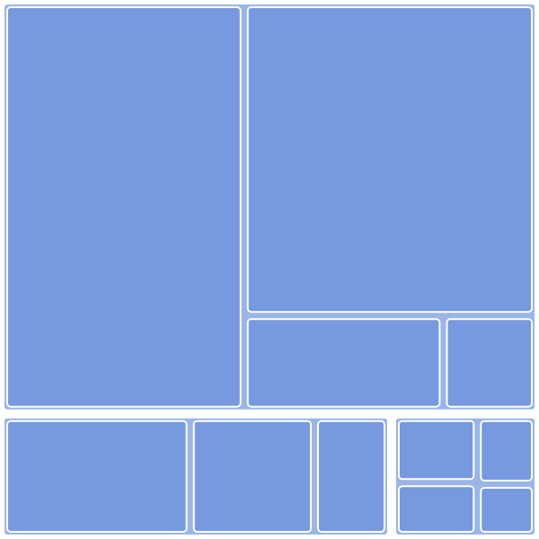
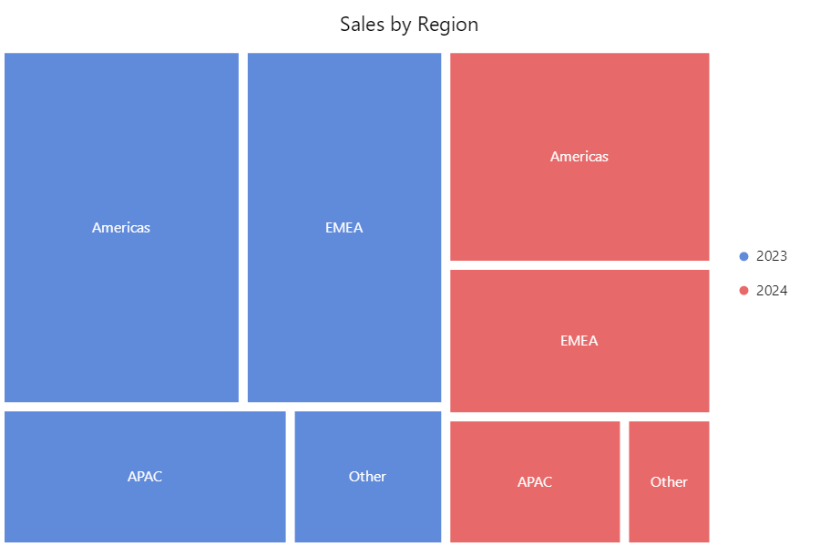
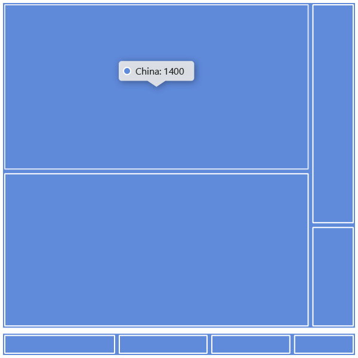

<!--
To get help on editing this file, see https://github.com/beto-rodriguez/LiveCharts2/blob/master/docs/readme.md
Samples are pulled from the repository with render_sample, the code shown always matches the samples.
-->

# Treemaps

The `TreemapChart` control draws hierarchical data as nested rectangles with `TreemapSeries`. Every node of the
hierarchy is a rectangle, its area is proportional to its value, and the children of a node are drawn inside it. The
chart has no axes: the series share the whole draw margin. This article covers the control and the treemap series
together.

:::info
The TreemapChart is available since LiveCharts 2.3. This article highlights the most used features. Every property
is listed in the API explorer:
[TreemapChart]({{ website_url }}/api/{{ version }}/LiveChartsCore.SkiaSharpView.{{ platform }}.TreemapChart),
[TreemapSeries]({{ website_url }}/api/{{ version }}/LiveChartsCore.SkiaSharpView.TreemapSeries-3) and
[TreemapNode]({{ website_url }}/api/{{ version }}/LiveChartsCore.Defaults.TreemapNode).
{{~ if xaml ~}}
In XAML, declare the series as `XamlTreemapSeries`.
{{~ end ~}}
:::

## Basic treemap

Set the `Values` of a `TreemapSeries<TreemapNode>` to the root nodes of the hierarchy and add the series to the chart.
`TreemapNode` is the built-in node type: `new TreemapNode(value, name)` creates a leaf, and
`new TreemapNode(name, children)` creates a node that contains other nodes. In this sample the regions are the
roots and the countries are their leaves. The series sets `Fill`, `Stroke` and `DataLabelsPaint`, see the sections
below.

{{ render_sample "treemaps/basic" }}

## Hierarchy and values

The value of a leaf sets its area. A node with children and no `Value` (`0`) takes the sum of the values of its
children, at any depth; in the basic sample, Asia takes the sum of its four countries. A node with children and a
value of its own uses that value for its area, and its children share that area in proportion to their own values.

A node whose resulting value is `0` or negative, `NaN` or infinite is not drawn, and neither are its children.

Every node is drawn as a tile, the nodes with children too: their children are drawn on top of them, inside the
tile. Only the leaves have labels, tooltips and pointer events.

## Layout

The series uses the squarified treemap algorithm (Bruls, Huijing and van Wijk, 2000): it places the siblings in rows,
from the largest value to the smallest, and picks the rows that keep every rectangle as close to a square as
possible. The layout does not follow the order of the nodes in the collection: in the basic sample Asia, the largest
region, is on the left, then Americas and Europe.

## Padding and corners

`Padding` insets every tile by that many pixels on each side, `2` by default, so there is a gap between siblings and
between a node and its children. With `0`, the children cover their parent completely.

`CornerRadius` rounds the corners of every tile, in pixels, `0` by default.



```csharp
new TreemapSeries<TreemapNode>
{
    Values = regions,
    Padding = 4, // mark
    CornerRadius = 4, // mark
    Fill = new SolidColorPaint(new SKColor(96, 138, 218, 160)),
    Stroke = new SolidColorPaint(SKColors.White) { StrokeThickness = 2 }
}
```

In this image the fill is semi-transparent, so the tiles of the regions show around the countries drawn on top of
them.

## Stroke and fill paints

`Fill` paints every tile and `Stroke` draws its border. The same paints are used at every level of the hierarchy. To
give each group its own color, use one series per group, see [several series](#several-series).

```csharp
new TreemapSeries<TreemapNode>
{
    Values = regions,
    Fill = new SolidColorPaint(new SKColor(96, 138, 218)), // mark
    Stroke = new SolidColorPaint(SKColors.White) { StrokeThickness = 2 } // mark
}
```

:::info
Paints can also draw gradients and dashed lines, see the
[Paints article]({{ website_url }}/docs/{{ platform }}/{{ version }}/Overview.Paints).
:::

## Labels

Setting `DataLabelsPaint` draws a label in the center of every leaf; setting `ShowDataLabels` to `true` instead
uses a text color from the theme. The label is the `Name` of the node, or the result of `LabelMapper`, see
[custom data types](#custom-data-types). `DataLabelsSize` sets the text size, `16` by
default. A label that does not fit inside its tile is hidden: in the basic sample Mexico and the European countries
have no label. The tiles of nodes with children have no label.

## Custom data types

Any class can be a node. Set three functions on the series: `ValueMapper` returns the value of a node,
`ChildrenMapper` returns its children, or `null` for a leaf, and `LabelMapper` returns its label. `ValueMapper` is
required when the type is not `TreemapNode`. A `TreemapSeries<TreemapNode>` sets the three of them for you.

```csharp
public class Folder
{
    public string Name { get; set; } = "";
    public double Size { get; set; }
    public List<Folder>? Children { get; set; }
}
```

```csharp
new TreemapSeries<Folder>
{
    Values = folders,
    ValueMapper = folder => folder.Size, // mark
    ChildrenMapper = folder => folder.Children, // mark
    LabelMapper = folder => folder.Name, // mark
    Fill = new SolidColorPaint(new SKColor(96, 138, 218)),
    DataLabelsPaint = new SolidColorPaint(SKColors.White)
}
```

As with `TreemapNode`, a folder with children and a `Size` of `0` takes the sum of its children.

`TreemapSeries<TModel, TVisual>` draws the tiles with another geometry: any `BoundedDrawnGeometry`. The default
is a `RoundedRectangleGeometry`; `CornerRadius` only applies to rounded rectangles.

## Several series

A treemap chart takes only treemap series. When it has more than one, the chart first splits the draw margin
between the visible series with the same squarified layout, in proportion to the sum of the root values of each
series, and then every series lays out its nodes in its own part. Use it to compare data sets, or to give each group
its own color. In this image the 2023 series has a total of 153 and the 2024 series a total of 92:



```csharp
Series = new ISeries[]
{
    new TreemapSeries<TreemapNode>
    {
        Name = "2023",
        Values = new[]
        {
            new TreemapNode(60, "Americas"),
            new TreemapNode(50, "EMEA"),
            new TreemapNode(28, "APAC"),
            new TreemapNode(15, "Other")
        },
        Padding = 4,
        Fill = new SolidColorPaint(new SKColor(96, 138, 218)), // mark
        Stroke = new SolidColorPaint(SKColors.White) { StrokeThickness = 2 },
        DataLabelsPaint = new SolidColorPaint(SKColors.White)
    },
    new TreemapSeries<TreemapNode>
    {
        Name = "2024",
        Values = new[]
        {
            new TreemapNode(40, "Americas"),
            new TreemapNode(28, "EMEA"),
            new TreemapNode(16, "APAC"),
            new TreemapNode(8, "Other")
        },
        Padding = 4,
        Fill = new SolidColorPaint(new SKColor(232, 105, 105)), // mark
        Stroke = new SolidColorPaint(SKColors.White) { StrokeThickness = 2 },
        DataLabelsPaint = new SolidColorPaint(SKColors.White)
    }
};

LegendPosition = LegendPosition.Right;
```

## Tooltips and legends

The tooltip opens over a leaf and shows the series `Name`{{ if xaml }} (`SeriesName` in XAML){{ end }}, when it is
set, and the label and value of the leaf, as `China: 1400`, or only the value when the leaf has no label. The tooltip
has no header. With `TooltipPosition` set to `Auto`, the default, it points at the center of the tile; the other
positions work as on a Cartesian chart, and `Hidden` disables the tooltips.



`ToolTipLabelFormatter` builds the text instead. The point's `Model` is the leaf node, and `Coordinate.PrimaryValue`
is its value:

```csharp
new TreemapSeries<TreemapNode>
{
    Values = regions,
    Fill = new SolidColorPaint(new SKColor(96, 138, 218)),
    ToolTipLabelFormatter = point =>
        $"{point.Model?.Name}: {point.Coordinate.PrimaryValue:N0} million" // mark
}
```

The legend is hidden by default: set `LegendPosition` to `Top`, `Bottom`, `Left` or `Right` to show it. It lists one
entry per series, with the `Fill` of the series.

The [tooltips and crosshairs]({{ website_url }}/docs/{{ platform }}/{{ version }}/CartesianChart.Tooltips%20and%20crosshairs)
and [legends]({{ website_url }}/docs/{{ platform }}/{{ version }}/CartesianChart.Legends) articles cover their text,
paints and custom controls.

## Title and animations

The `TreemapChart` also takes the `Title`, `DrawMargin`, `AnimationsSpeed` and `EasingFunction` properties of every
chart; the image in [several series](#several-series) has a `Title`. See the
[Cartesian chart control]({{ website_url }}/docs/{{ platform }}/{{ version }}/CartesianChart.Cartesian%20chart%20control#title)
and [animations]({{ website_url }}/docs/{{ platform }}/{{ version }}/Overview.Animations) articles.

When the data changes, every tile animates to its new rectangle. Tiles are matched by node instance: a new node grows
from the center of its tile, and a removed node shrinks to its center.

## Data, names and updates

- `Values` takes the root nodes. Use an `ObservableCollection<T>` and the chart updates when a root is added, removed
  or replaced, see [automatic updates]({{ website_url }}/docs/{{ platform }}/{{ version }}/Overview.Automatic%20updates).
  `TreemapNode` does not notify changes, and the children collections are not observed.
- `Name`{{ if xaml }} (`SeriesName` in XAML){{ end }} is shown in tooltips and legends.
